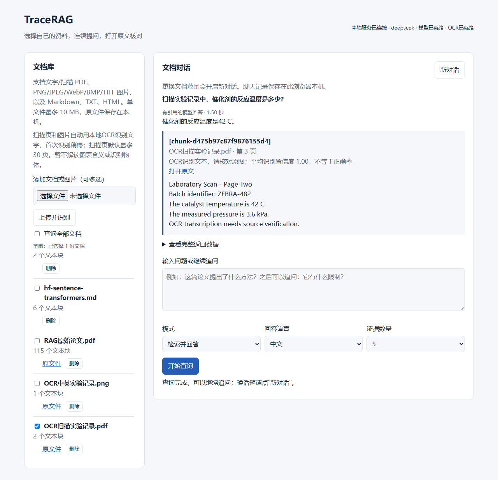

# TraceRAG

当前版本 **0.4.0**：双击项目中的 **启动TraceRAG.cmd**，上传文档或图片后提问。支持勾选文档范围、多文件上传、连续追问、刷新恢复对话、原文件与PDF页码引用；新增本地中英文OCR，支持扫描PDF和PNG/JPEG/WebP/BMP/单帧TIFF。见[日常使用](docs/daily-use.md)和[图片与扫描PDF识别](docs/ocr.md)。

端到端链路：上传PDF/Markdown/TXT/HTML/图片 → 原生文字提取或RapidOCR → SQLite持久化 → 双向查询翻译 + BM25/Dense → RRF → 可选BGE重排 → DeepSeek作答 → Chunk引用校验。支持中文网页、FastAPI、受限工具循环、增量向量缓存和常驻模型。扫描PDF按页回退OCR，保留实际页码；识别置信度不等于正确率，引用可打开原图或PDF核对。

已用19页完整公开论文通过真实DeepSeek与Edge浏览器验收；新增OCR合成实验记录实测返回效率23.5%和PDF第3页温度42 C，原图与页码链接通过浏览器核对。这是链路功能验证，不是OCR准确率评测。见[OCR实测记录](docs/evidence/ocr-live-validation.json)和[浏览器验收截图](docs/assets/ocr-scan-answer.png)。



**当前机器启动：** PowerShell在项目目录执行 `.\start.ps1`，打开 [本地网页](http://127.0.0.1:8000) 或 [API文档](http://127.0.0.1:8000/docs)。首次查询加载模型，以后复用。

完整配置和命令见 [快速开始](docs/quickstart.md)，故障排查见 [运行指南](docs/runbook.md)，真实评测见 [评测说明](docs/evaluation.md)，交付范围见 [完成记录](docs/completion.md)。下方保留Day1～Day5教学脚本用法。

TraceRAG 是一个面向技术文档的「可追溯、评测优先」RAG 与工具调用服务。项目目标是准备华为 AI 应用工程师实习岗，而不是再做一个只能演示的 PDF 聊天机器人。

## 当前状态

Day 1～Day 5 的独立教学组件如下，后续端到端入口使用上方当前版本说明：

- 与模型供应商解耦的 `LLMClient` 接口；
- 确定性 Mock 模型客户端；
- 最小问答 Pipeline 和来源 ID 传递；
- 2 篇本地演示文档和 25 篇公开技术资料清单；
- 单元测试、冒烟脚本和接口文档；
- 第一版架构图和 15 天交付计划；
- 本地 `.venv`，TraceRAG 已以可编辑模式安装。
- 通过 OpenAI-compatible SDK 成功调用 DeepSeek 真实模型。
- Markdown 和按页 PDF 文本提取；
- 保留 source、page number 和字符区间的确定性切块。
- 本地多语言 Embedding、余弦相似度和内存 top-k 稠密检索；
- 检索结果保留 Chunk、score、rank 和全部来源元数据。
- jieba 词级 BM25、中文字符 2/3-gram BM25，以及本地 Qwen3/MarianMT/DeepSeek 查询翻译增强的跨语言 BM25 家族检索。
- 基于名次而非原始分数的 RRF、Chunk 去重和稳定平局规则。

Mock 路径不需要 API Key；DeepSeek 路径仅在运行时读取密钥。仓库不保存真实凭据。

## 运行

```powershell
cd "D:\Desktop\实习\TraceRAG"
.\.venv\Scripts\Activate.ps1
python scripts\day1_smoke.py
python -m unittest discover -s tests -v
```

Day 2 文档接入：

```powershell
python scripts\day2_ingest.py data\demo\rag_evaluation.md --max-chars 120 --overlap-chars 20
python scripts\day2_ingest.py "D:\path\to\paper.pdf"
```

Day 3 稠密检索（首次运行会下载约 220 MB 的本地模型）：

```powershell
python scripts\day3_dense.py data\demo\rag_evaluation.md data\demo\traceability.md `
  --query "为什么要分别评估检索和生成？" --top-k 3 --max-chars 180 --overlap-chars 30
```

Day 4 BM25 词法检索：

```powershell
python scripts\day4_bm25.py data\demo\rag_evaluation.md data\demo\traceability.md `
  --query "source identifiers citations" --top-k 3 --max-chars 180 --overlap-chars 30
```

面对词典外中文专业词时，可切换到独立的字符 2/3-gram 索引：

```powershell
python scripts\day4_bm25.py <中文文献路径> `
  --query "钙钛矿结构" --analyzer char-ngram --top-k 3
```

中文问题检索英文文献（使用 `.env` 中的 DeepSeek API Key 翻译查询）：

```powershell
python scripts\day4_crosslingual_bm25.py `
  data\demo\rag_evaluation.md data\demo\traceability.md `
  --query "为什么要分别评估检索和生成？" --top-k 3
```

Day 5：融合 BM25 家族与 Dense 排名：

```powershell
python scripts\day5_rrf.py `
  data\demo\rag_evaluation.md data\demo\traceability.md `
  --query "为什么要分别评估检索和生成？" `
  --top-k 3 --candidate-k 5
```

Day 5 默认使用本地 `Qwen/Qwen3-0.6B` 做中英双向查询翻译。首次使用先安装可选依赖并下载约1.5 GB 权重；之后直接从本地缓存读取，不需要 API Key：

```powershell
python -m pip install -e ".[local-translation]"
```

本机 RTX 4060 已验证使用 PyTorch 2.14 的 CUDA 13.0 官方 wheel。若安装可选依赖后得到的是 `+cpu` 版本，可在项目虚拟环境中替换：

```powershell
python -m pip install --force-reinstall --no-deps torch==2.14.0 `
  --index-url https://download.pytorch.org/whl/cu130
python -c "import torch; print(torch.__version__, torch.cuda.is_available(), torch.cuda.get_device_name(0))"
```

四种翻译模式：

```powershell
# 默认：Qwen3 双向本地翻译，不需要 API Key
python scripts\day5_rrf.py <文献路径> --query "中文或英文问题" --translator qwen

# 轻量 Marian 中译英基线；不支持英译中
python scripts\day5_rrf.py <文献路径> --query "中文问题" --translator marian

# DeepSeek 翻译
python scripts\day5_rrf.py <文献路径> --query "中文或英文问题" --translator deepseek

# 关闭查询翻译，作为消融对照
python scripts\day5_rrf.py <文献路径> --query "中文问题" --translator none
```

首次使用时，将 DeepSeek API Key 保存到被 Git 忽略的 `.env`：

```powershell
python scripts\configure_api_key.py
```

之后运行真实调用无需重复输入：

```powershell
python scripts\day1_live.py
```

在新机器重建环境：

```powershell
python -m venv .venv
.\.venv\Scripts\Activate.ps1
python -m pip install -e .
```

如果只有 Windows Python Launcher，可将第一条改为 `py -3.11 -m venv .venv`。

## 目标链路

```text
PDF/Markdown/TXT/HTML/图片 -> 原生提取/本地OCR -> 清洗/切块
                         -> 跨语言 BM25 家族 + 稠密检索
                         -> RRF 融合 -> 重排 -> LLM 作答
                         -> 原文件/页码/块级引用 -> 离线评测
```

## 工程原则

1. 简历中的每项声明都必须有可运行代码或实测结果支撑。
2. AI 生成代码必须通过人工理解、测试和验收标准。
3. 不向仓库提交任何供应商凭据。
4. 评测与功能同步建设，而不是演示完成后再补。

详见 `docs/architecture.md`、`docs/interfaces.md`、`docs/day1.md` 和 `docs/15-day-plan.md`。
