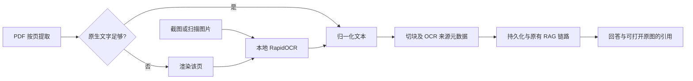

# 架构决策记录

## 0.4.0 图片与扫描文档接入

图片先由本地RapidOCR提取文字；PDF逐页优先提取原生文字，缺少文字的页再渲染后OCR。识别文本进入已有切块、检索和生成链路；Chunk保存`extraction_method`、`ocr_confidence`与物理页码，原文件单独持久化，便于从引用核对。OCR置信度不等于识别正确率。模型在同一进程懒加载并复用，PDFium渲染使用全局锁。



这是文字识别链路，不包含图表语义理解或复杂公式版面还原。默认限制与真实验收见[OCR说明](ocr.md)。

## 0.2.0 当前可执行链路

网页/API/CLI → RAGService → SQLite文档/Chunk → BM25家族 + Dense → RRF → 可选BGE重排 → DeepSeek结构化回答 → 引用ID校验。查询翻译支持中英双向，模型常驻；按模型revision/内容缓存向量，新增文档只嵌入未缓存文本。MiniLM固定ONNX revision和mean pooling。

ToolAgent只允许search/read_chunk，最大步数可配置，引用必须来自实际工具观察。服务默认单进程本机访问；测试覆盖数据库恢复、重复上传、并发幂等、API及引用失败边界。人工标注/事实支持度审核与Docker运行验收见completion.md；下面保留原Day1～Day5的历史设计过程。

## 项目定位

TraceRAG 面向公开技术文档回答问题，返回可核验的引用，并测量 Pipeline 在哪个环节失败。它是一个工程与评测项目，不是聊天界面演示。

## 计划组件

1. 文档接入：PDF、Markdown 和 HTML 解析、归一化与元数据保留。
2. 文本切块：可配置块大小、重叠范围和稳定 chunk id。
3. 检索：词级 BM25、字符 n-gram BM25、查询翻译增强 BM25 和稠密检索共用统一接口。
4. 融合：Reciprocal Rank Fusion（RRF）与去重。
5. 重排：可选 Cross-Encoder 或供应商 Reranker。
6. 生成：供应商无关客户端、Grounded Prompt 和引用。
7. 评测：Recall@k、MRR、引用命中率、答案正确性和延迟。
8. 服务：FastAPI 端点、校验、日志和错误映射。

## 第一版架构图

```mermaid
flowchart LR
    subgraph Offline[离线接入与建索引]
        S[公开资料清单] --> P[PDF / Markdown / HTML 解析]
        P --> C[归一化与切块]
        C --> M[元数据与稳定 chunk id]
        M --> BW[词级 BM25 索引]
        M --> BC[字符 n-gram BM25 索引]
        M --> V[稠密向量索引]
    end

    subgraph Online[在线查询链路]
        Q[用户问题] --> BWR[原查询词级 BM25]
        Q --> BCR[原查询字符 BM25]
        Q --> T[中英文查询双向翻译]
        T --> EBR[英文查询词级 BM25]
        Q --> DR[稠密检索]
        BW --> BWR
        BW --> EBR
        BC --> BCR
        V --> DR
        BWR --> BF[BM25 家族最佳名次去重]
        BCR --> BF
        EBR --> BF
        BF --> F[RRF 融合]
        DR --> F
        F --> RR[可选重排]
        RR --> G[Grounded Prompt + LLM]
        G --> A[答案 + chunk 级引用]
    end

    subgraph Evaluation[离线评测]
        E[人工核验的评测集] --> Q
        A --> R[Recall@k / MRR / 引用命中率 / 延迟]
    end
```

Day 1 只有「构造 Grounded Prompt → Mock」可执行。架构图表示目标形态，不代表每个模块已实现。

Day 2 已将「Markdown/PDF 解析 → 归一化 → 稳定 chunk id」变为可执行链路；BM25 和稠密索引仍属于后续任务。

Day 3 已将「多语言 Embedding → 余弦相似度 → top-k 稠密检索」变为可执行链路。当前索引是内存穷举 Baseline，尚未使用向量数据库或近似最近邻索引；BM25 属于 Day 4。

当前 MiniLM 是待评测的基线而非最终模型。Day 7 将在固定语料、切块、查询和 top-k 的条件下，对比 MiniLM、Qwen3-Embedding-0.6B 及其与 BM25/RRF 的组合，避免同时改变多个变量后无法归因。

Day 4 已将「jieba 词级分词 / 中文字符 2-gram 与 3-gram → 独立倒排表 → BM25 → top-k」变为可执行链路。字符通道用于召回词典外专业词。查询翻译通道现在双向扩展：中文问题补英文词项，英文问题补中文词项；跨语言能力来自翻译层而非 BM25 公式。原查询与译文的词级/字符级结果先按最佳名次压成一张 BM25 家族榜，Day 5 再让它与 Dense 各自作为一票参与 RRF，避免相关词法通道重复投票。

Day 5 已将「BM25 家族榜 + Dense 榜 → RRF 分数 → chunk id 去重 → 稳定 top-k」变为可执行链路。融合层只读取名次，不直接比较两种检索器的原始 score；重排和生成接入仍属于后续工作。

## Day 1 决策

- LLM 接口与检索、API 框架分离。
- 真实供应商未配置前使用确定性 Mock。
- 从第一天开始将 source id 作为一等数据。
- 先建立评测样例，再优化检索。
- C++ 用于笔试与算法，Python 用于 AI 应用项目。

## Day 15 验收标准

- 一条命令本地启动；
- 文档接入和稳定 chunk id；
- Dense、BM25 和融合检索；
- 重排与有依据的生成；
- API 返回块级引用；
- 30–50 条人工核验评测问题；
- Baseline 和消融实验结果；
- 单元测试与集成测试；
- 可复现 README 和架构图。
